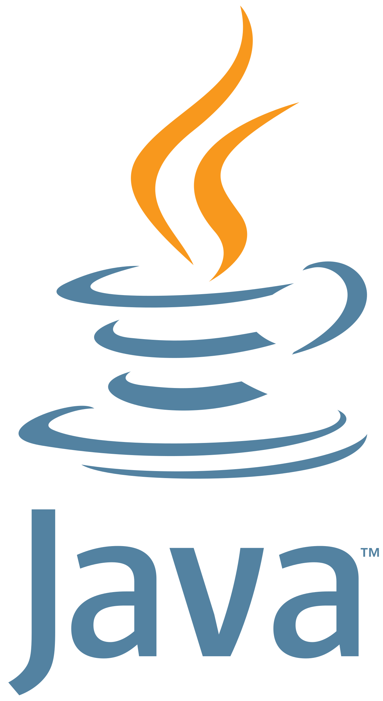

# Hi there, I'm Morzel Chambers👋

## About Me
I'm a junior software engineer passionate about mobile and native application development.
- 🔭 I’m currently working on updating and modernizing a few of my projects like the "Can't Decide: Charities" App
- 🌱 I’m currently learning Rust, Kotlin, and Django
- 📫 How to reach me: [chambers.morzel@gmail.com]
- 😄 Pronouns: he/him
- ⚡ Fun fact: I love playing RPGs and doing voice impressions!

## Connect With Me

## My Tech Stack:
       
## My Github Stats:

